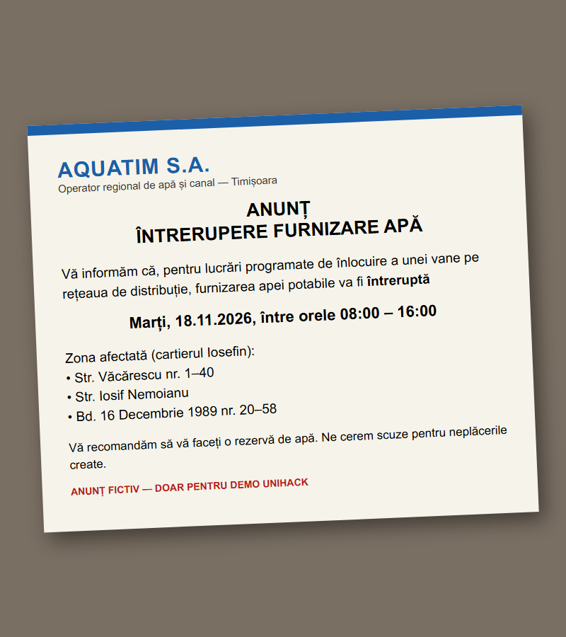
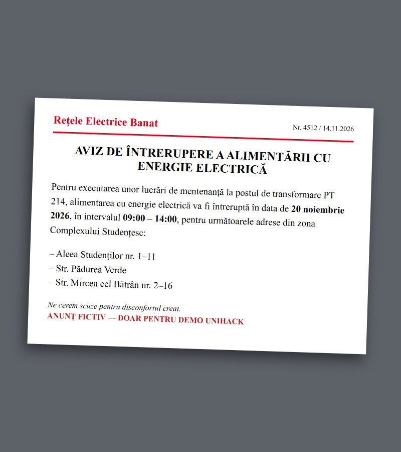

<p align="center">
  
  
</p>

<p align="center">
  
</p>

<h1 align="center">hop</h1>
<h3 align="center">One App for Timișoara · Live City Alerts · Ask It Out Loud</h3>

<p align="center">
  <strong>🏛️ Built in 48 hours at UNIHACK 2026 · 13 modules · iOS · Android · Web</strong><br>
  <em>Everything in Timișoara, one tap away. · Tot Timișoara-ul, la un tap distanță.</em>
</p>

<p align="center">
  
  
  
  
  
  
  
  
  
  
  
  
  
</p>

---

## ✨ What is hop?

hop is **one community hub for Timișoara, Romania**. The city already has the information residents need (utility cuts, tram detours, parking, safety, events), but it is scattered across press releases, door notices, Facebook groups and sensors that don't talk to each other. hop **ingests** those signals, **understands** them with AI, **protects** them with real identity and privacy rules, and **delivers** them in plain words, on a map, or **out loud in Romanian**.

```text
📄 Notice photo / 📷 Camera / 🌬️ Sensors / 🗣️ Resident reports
        →  🤖 AI (Gemini · YOLO11 · embeddings)
        →  🔐 Auth0 (roles + step-up MFA)  →  ⚡ City Hub API  →  🗄️ Tiger Cloud
                                                                 →  📱 Resident app
                                                                 →  🖥️ Staff website
                                                                 →  🔊 Voice assistant
```

### How it works

1. **City staff** (on the **website**) photograph a utility notice. **Gemini** reads it in about 2 seconds into a structured draft, with warnings for anything it cannot read.
2. A staff member with a **second check (Auth0 step-up MFA)** confirms and publishes the alert. Residents can never publish city-wide alerts.
3. **Residents** (in the **app**) see it instantly in plain words: *"Hot water is off until about 18:00."*
4. They can **ask out loud**: *„Am apă miercuri pe strada Văcărescu?"* and hop answers in a native Romanian voice (**ElevenLabs**).
5. Everything residents report (smells, unsafe places, forum posts) flows into **Tiger Cloud** time-series storage, where staff see it grouped into incidents by Gemini embeddings and can ask questions of the data.

> *"O poză devine o alertă oficială în 10 secunde, iar orice locuitor o poate afla vorbind cu aplicația."*

---

## 🧩 The 13 Modules

Every module is an **independent vertical slice** (screens, API routes, DB schema, seed data, AI tools). A broken module is flipped to `draft` and disappears; the rest keeps running.

| | Module | What it does |
|---|--------|--------------|
| 🎭 | **M01 Events** | Discover, create and RSVP to micro-events. RSVP mints a **Solana devnet ticket**. |
| ℹ️ | **M02 Visitor Info** | Bilingual practical info (112, tickets, airport, money) with a "check before you travel" badge. |
| 🛡️ | **M03 Safety** | Privacy-safe resident reports about *places*, safe places (hospital / police / fire), danger and works zones, Gemini area summaries. |
| 💧 | **M04 Utilities** | Heat, water and power outages matched to your street, with crowd confirmations. |
| 🚋 | **M05 Transit** | Suspended and detoured lines, "is my stop served?" check (tram 5 → bus 5C). |
| 👃 | **M06 Smell** | One-tap smell reports, live map, 24 h chart and **wind-based source hint**. |
| 🤝 | **M07 Buddy "Cu Cine?"** | Find someone to go to an event with: interest matching, icebreakers, group chat. |
| 💬 | **M08 Forum** | Neighbourhood board (lost pets, help, buy/sell) with upvotes, reports and a moderator queue. |
| 🎟️ | **M09 Wallet** | Per-user Solana wallet: QR tickets, door check-in, on-chain **POAP** badges. |
| 🗣️ | **M10 Assistant** | Gemini chat with function calling over every module, voice in/out, notice scanner, staff analyst, audio tour. |
| 💗 | **M11 Feedback** | In-app feedback, live survey sync, public changelog, analytics by app version. |
| 📊 | **M12 Dashboard** | Staff overview from continuous aggregates and open-data export. |
| 🅿️ | **Parkie** | Our previous award-winning smart-parking project, ported in as a module (see below). |

---

## 📸 Showcase

### 🖼️ Brand & Demo Material
<p align="center">
  
</p>
<p align="center">
  
  
</p>
<p align="center"><sub>Both sample notices are stamped <b>ANUNȚ FICTIV</b> (fictional notice). The full brand board lives in <code>docs/brand/brand-board.html</code>.</sub></p>

---

## 🏗️ Architecture

```text
┌──────────────────────────────────────────────────────────────────────┐
│                           hop · UNIHACK 2026                         │
├───────────────┬───────────────────┬──────────────────────────────────┤
│  📱 App        │  🖥️ Staff Website  │  🤖 AI Services                  │
│  Expo SDK 58  │  Vanilla ES SPA   │  Gemini 3.5 Flash-Lite (+Flash)  │
│  iOS·Android  │  Dashboard · MFA  │  gemini-embedding-001            │
│  Web          │  Parking cameras  │  ElevenLabs eleven_v4 · Scribe   │
│  Shared map   │  Scan a notice    │  YOLO11m + OpenCV (Parkie)       │
├───────────────┴───────────────────┴──────────────────────────────────┤
│  ⚡ City Hub API  (Node 22 · type-stripping · Hono + http)            │
│  /v1/core/*  ·  /v1/m/<module>/*  ·  per-module fault isolation      │
│  Auth0 JWT (jose/JWKS) · RBAC · step-up MFA · rate limits · flags    │
├──────────────────────────────────────────────────────────────────────┤
│  🗄️ Tiger Cloud (TimescaleDB 2.32 · PostgreSQL 16 · PostGIS)         │
│  5 hypertables · 4 continuous aggregates · compression · retention   │
├────────────────────────────┬─────────────────────────────────────────┤
│  ⛓️ Solana devnet           │  🌍 Open services                       │
│  SPL Memo tickets · POAP   │  OpenStreetMap · OSRM · Nominatim       │
│  Explorer + Developer MCP  │  Open-Meteo wind · Google Forms/Sheets  │
└────────────────────────────┴─────────────────────────────────────────┘
```

**Principles:** vertical-slice modules · frozen core · contracts first (`@hub/contracts`) · mock-first adapters (everything works with no database or API key and labels itself "simulated") · feature flags (`draft` / `beta` / `live`) · extension points via module manifests (Home cards, Map layers, assistant tools).

---

## 📂 Project Structure

```text
unihackers/
├── apps/
│   ├── app/                  # Expo app: iOS · Android · Web (Expo Router)
│   │   ├── app/              # Routes: (tabs)/, alerts/, m/<module>/
│   │   └── src/
│   │       ├── core/         # auth, API client, map layers, alerts, i18n
│   │       └── modules/      # m01-events … m12-dashboard, parkie
│   └── web/                  # Staff + resident website (vanilla ES modules)
│       └── src/views/        # Home, Map, Alerts, Community, Parking, Assistant, Admin …
│
├── services/
│   ├── api/                  # City Hub API
│   │   └── src/
│   │       ├── core/         # auth, db, flags, geocode, routing, safe places, MCP client …
│   │       └── modules/      # m01 … m12, parkie (routes · service · seed · assistant-tools)
│   ├── workers/              # Netrom "glue" ingestion (Colterm / STPT / sensors)
│   ├── parkie-vision/        # Python CV agent (YOLO11 + live feed server)
│   └── vision/               # Earlier Parkie vision copy (capture / slot selection)
│
├── packages/
│   ├── contracts/            # Shared zod schemas, types and seed data
│   ├── ui/                   # hop design system (components, tokens, illustrations)
│   ├── map/                  # Map engine (MapLibre) + layer API + pin registry
│   ├── solana/               # Ticket / POAP logic, Explorer links
│   ├── api-client/           # Typed fetch client
│   └── config/
│
├── db/
│   ├── core/migrations/      # users, areas, places, flags, audit, avatars
│   └── modules/<module>/     # one schema + migrations per module
│
├── docs/                     # brand · demo script · living labs · voice tour · visitor info
├── infra/auth0/              # Post-Login Action + Auth0 guide
├── scripts/                  # dev launchers, migrators, seeders, test harnesses
└── .github/                  # CI + CODEOWNERS
```

---

## 🚀 Quick Start

### Prerequisites

- **Node.js 22+** (the API runs TypeScript natively with `--experimental-strip-types`)
- **Python 3.10+** (tests, Tiger migration scripts, the Parkie vision agent)
- A `.env` in the repo root (see below). **Without `DATABASE_URL`, everything still works in memory** and dashboards say "simulated".

### Setup & run

```bash
npm install                     # installs all workspaces

npm start                       # API on http://localhost:8000
npm run dev:web                 # staff website on http://localhost:3000
npm run dev:workers             # ingestion workers (Gemini + Colterm/STPT/sensors)

# resident app (PowerShell on Windows, not Git Bash)
cd apps/app
npx expo start --web            # http://localhost:8081
```

On a phone: `npm run dev:app:tunnel` (ngrok) or `npm run dev:app:wifi`.

### Environment variables

| Variable | Purpose |
|----------|---------|
| `DATABASE_URL` | Tiger Cloud (TimescaleDB) connection string |
| `GEMINI_API_KEY` | Gemini: assistant, notice scanner, analyst, incident radar |
| `ELEVENLABS_API_KEY` | Text-to-speech and speech-to-text |
| `AUTH0_DOMAIN` · `AUTH0_AUDIENCE` · `AUTH0_CLIENT_ID` · `AUTH0_WEB_CLIENT_ID` | Auth0 login and JWT verification |
| `SOLANA_ORGANIZER_SECRET_KEY` · `SOLANA_ORGANIZER_PUBLIC_KEY` | Devnet organizer wallet (signs tickets and POAPs) |
| `FEEDBACK_INGEST_TOKEN` · `SURVEY_SYNC_URL` | Living Labs survey ingest and sync |
| `PARKIE_VIDEO` | Demo video the Parkie vision agent loops as a camera |
| `DEMO_AUTH` · `STAFF_EMAILS` | Demo sign-in switch (off in production) and staff allow-list |

Never commit `.env`. It is git-ignored.

### Test & verify

```bash
npm test                  # boots-and-checks the core API suite (scripts/test_p2.py)
npm run test:modules      # all modules
npm run test:auth         # Auth0 / roles end to end
npm run test:solana       # live Solana devnet mint check
npm run test:workers      # ingestion workers
npm run demo:auth0        # interactive Auth0 judge demo
npm run verify:all        # full master verification
```

---

## 📡 API Endpoints (highlights)

Everything lives under `/v1/core/*` (platform) and `/v1/m/<module>/*` (modules). Full reference: [REQUIREMENTS.md](REQUIREMENTS.md).

| Method | Endpoint | Description |
|--------|----------|-------------|
| `GET` | `/health` | Health + version |
| `GET` | `/v1/core/areas` | The 13 Timișoara neighbourhoods |
| `GET` | `/v1/core/auth/me` | Roles, permissions, MFA status |
| `GET` | `/v1/core/auth/audit-log` | Security audit trail (moderator / admin) |
| `GET` | `/v1/core/route` | Directions that avoid danger zones and list help nearby |
| `GET` | `/v1/core/tiger/status` | Live hypertables, aggregates, compression |
| `GET` | `/v1/core/open-data/export` | Anonymised aggregates (JSON / CSV) |
| `GET` | `/v1/m/utilities/outages` | Active outages |
| `POST` | `/v1/m/utilities/check-address` | Is my address affected? |
| `POST` | `/v1/m/transit/check-stop` | Is my stop served? |
| `GET` | `/v1/m/parkie/lots` | Parking lots with live occupancy and colour |
| `POST` | `/v1/m/parkie/detections` | Camera agent reports cars (staff / agent) |
| `POST` | `/v1/m/events/:id/rsvp` | RSVP and mint a Solana ticket |
| `POST` | `/v1/m/buddy/match` | Interest-based buddy matching |
| `POST` | `/v1/m/forum/:id/report` | Report a post for moderation |
| `POST` | `/v1/m/wallet/check-in` | Door scan, verify, issue POAP |
| `POST` | `/v1/m/smell/reports` · `/v1/m/safety/reports` | One-tap resident reports (rate-limited) |
| `POST` | `/v1/m/assistant/chat` | Gemini assistant with tools |
| `POST` | `/v1/m/assistant/tts` · `/stt` | ElevenLabs speech out / in |
| `POST` | `/v1/m/assistant/notice/parse` | Photo → structured outage draft (Gemini vision) |
| `POST` | `/v1/m/assistant/notice/confirm` | Publish (staff + MFA) |
| `POST` | `/v1/m/assistant/analyst` | "Ask the data" (Gemini code execution, staff) |
| `GET` | `/v1/m/assistant/incidents` | Incident radar (Gemini embeddings, staff) |

---

## 🗄️ Database (Tiger Cloud)

| Hypertable | Continuous aggregate | Notes |
|------------|----------------------|-------|
| `parking_detection_events` | `parking_hourly_stats` | Camera detections, 15 min refresh |
| `city_metric_events` | `city_metrics_hourly_stats` | PM2.5, noise, smell per neighbourhood |
| `utility_outage_metrics` | none | Outage metrics |
| `m03_safety.reports` | `m03_safety.reports_hourly` | Safety reports, 7 day compression |
| `m06_smell.reports` | `m06_smell.reports_hourly` | Smell reports, 7 day compression |

Real-time aggregates are on, 90-day retention policies are set, and one schema per module has its own migrations in `db/modules/`. Time buckets use `Europe/Bucharest`. Also stored: users, wallets, forum, buddy chats, events, personal pins, survey answers and the **Auth0 audit trail**.

---

## 🤖 AI Pipeline

| Feature | How it works |
|---------|--------------|
| **City assistant** | Gemini **function calling** over every module's tools; replies in the user's language; never invents outages; times converted to Timișoara local time; knows whose wallet to read |
| **Notice scanner** | Gemini **vision + structured JSON** → draft outage; unreadable fields become warnings; human confirms |
| **Ask the data** | Gemini **code execution** + our data tools; runs Python on Google's side and returns a chart with its sources |
| **Incident radar** | `gemini-embedding-001` links forum posts and outages to report groups; structured output writes RO/EN incident cards |
| **Solana MCP** | A from-scratch MCP client lets the assistant verify tickets via Solana's **Explorer MCP** and answer from the **Developer docs MCP** |
| **Voice** | ElevenLabs **eleven_v4** (Romanian "Corina Ioana", English "Jessica") and **Scribe v3**; narrated 5-stop audio tour |
| **Parkie vision** | **YOLO11m** every 5 s, polygon matching, 5-frame majority vote, report every 15 s |

---

## 🔐 Security & Privacy

- **Auth0**: Universal Login (Google / passwordless / register), JWTs verified against JWKS, roles `resident · organizer · moderator · admin`.
- **Step-up MFA** for staff actions that affect the whole city; **Auth0 for AI Agents** (M2M) for ingestion; **adaptive location shield** with push + email; **audit log** persisted to Tiger Cloud.
- **Staff use the website, residents use the app**, enforced by the API.
- Shared pins snap to a 30–100 m grid; contact details and plates are stripped from safety notes; safety summaries use counts, not notes; routing sends only coordinates; API keys stay server-side; demo sign-in is disabled when `NODE_ENV=production`.

---

## 🧪 Living Labs (real users)

Survey (RO/EN, Google Forms → Sheets → our API → Tiger Cloud): **39 answers at v0**, average install intent **4.26 / 5**, and **parking was the #1 pick (14 of 39)**. Details, feedback → change log and numbers per app version: [docs/living-labs/](docs/living-labs/living-labs-log.md). Live figures: staff dashboard → **Analytics**.

---

## 🎨 Design System

hop is **friendly, calm and text-first**: white pages, hairline lists, flat illustrations, **one pink button per screen**. Spec: [docs/brand/identity.md](docs/brand/identity.md) · tokens: [docs/brand/design-tokens.json](docs/brand/design-tokens.json) · board: [docs/brand/brand-board.html](docs/brand/brand-board.html).

| Token | Value | Usage |
|-------|-------|-------|
| Background | `#F8F6FB` | Page / board |
| Ink | `#1A1033` | Text, icons, **every button label** |
| Pink | `#FF3D7F` | Logo and the single primary button |
| Blue | `#3D5BFF` | Getting around and info (transit, parking, assistant) |
| Mint | `#12C99B` | Home and services (utilities, wallet, feedback) |
| Apricot | `#FF7A2F` | Safety and warnings (safety, smell) |

Typography: **Nunito** (headlines) and **Figtree** (interface). Squircle corners, glass only on floating controls, 44 px touch targets, reduced-motion and reduced-transparency support.

---

## 🏆 Sponsor Challenges

| Challenge | How hop answers it |
|-----------|--------------------|
| **Netrom: Glue It Together** | Ingestion workers glue Gemini, utility press releases, transit notices, sensors, Auth0 M2M and Tiger Cloud; plus the photo → Gemini → MFA → publish → spoken-answer chain |
| **Solana** | Devnet tickets with SPL Memo, QR door check-in, on-chain POAP, MCP-verified by the assistant |
| **Vest Ventures: Living Labs** | In-app feedback, live survey, changelog, analytics by version |
| **ElevenLabs** | Spoken Romanian assistant, speech-to-text, narrated tour |
| **Google Gemini** | Function calling, vision, embeddings, code execution, structured output |
| **Auth0** | Universal Login, RBAC, step-up MFA, AI-agent M2M, audit trail |
| **Tiger Data** | 5 hypertables, 4 continuous aggregates, compression, retention, open-data export |

---

## 🤝 Contributing & Conventions

- All PRs merge into `main`; `.github/CODEOWNERS` maps each folder to its owner; CI runs the API test suite.
- Modules never import each other; they talk through core events, public read endpoints or deep links.
- Strip-types rule for any file the API loads: `.ts` on relative imports, `import type` for types, no `enum`s or constructor parameter properties.
- Every commit that adds routes, contracts or architecture updates [REQUIREMENTS.md](REQUIREMENTS.md).
- Commit messages are short and end with `:3`.

More docs: [REQUIREMENTS.md](REQUIREMENTS.md) · [docs/p4-progress.md](docs/p4-progress.md) · [infra/auth0/README.md](infra/auth0/README.md) · [services/parkie-vision/README.md](services/parkie-vision/README.md).

---

## 👥 Team UniHackers

Four builders, four lanes: **P1** design and app shell (plus the Parkie port), **P2** platform, data and city alerts, **P3** community and Solana, **P4** AI, voice and civic reports.

Built with ☕ and 🍜 at **UNIHACK 2026**.
:3

---

<p align="center">
  <sub>Made for UNIHACK 2026 · Timișoara, Romania 🇷🇴</sub>
</p>
