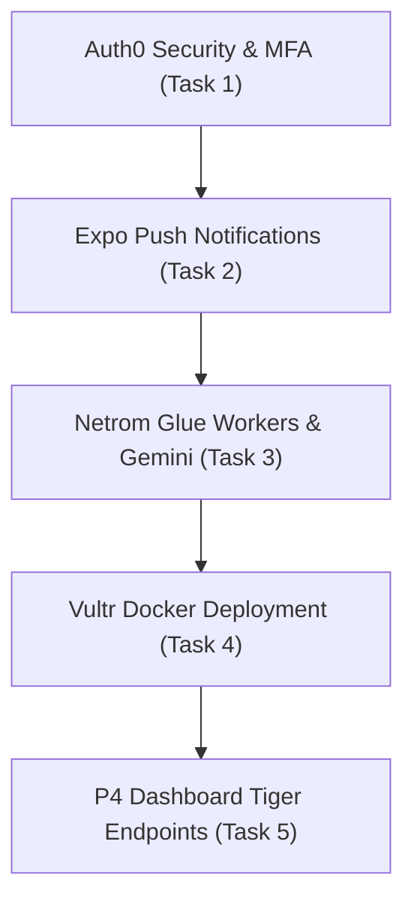

# 📋 Person 2 (P2) — Action Plan & Feature Roadmap
**Role:** Platform, Data and City Alerts Lead  
**Scope:** `packages/contracts`, `services/api/src/core`, `apps/app/src/core`, `services/workers`, `db/core`, `infra`, `[M04_UTILITIES]`, `[M05_TRANSIT]`  
**Sponsor Targets:** Tiger Data (Stream Deck Mini), Auth0 (Wireless Headphones), Netrom Glue, Vultr  

---

## 🏆 Current Progress & What's Already Complete
- [x] **Monorepo Contracts & Data Models:** Full Zod schemas & TypeScript contracts in [packages/contracts](file:///home/bisquitew/UNIHACK2026/unihackers/packages/contracts/src/index.ts).
- [x] **Core API Engine:** Zero-dependency fast HTTP server in [server.ts](file:///home/bisquitew/UNIHACK2026/unihackers/services/api/src/server.ts) with health, neighbourhoods, saved places, feature flags.
- [x] **[M04_UTILITIES] Backend:** Heating & water outage model, spatial address matching, crowd confirmations.
- [x] **[M05_TRANSIT] Backend:** STPT transit lines, detour alerts, "is my stop served" impact checker.
- [x] **[PARKIE] Backend:** Real-time lot status, color streaming, nearest-lot calculation, CV camera event ingestion.
- [x] **Vultr S3 Photo Storage:** Presigned upload URL generation & local binary file storage handler.
- [x] **Tiger Data (TimescaleDB Cloud):**
  - Live connection to TimescaleDB Cloud instance (`tsdb.cloud.timescale.com:30613`).
  - 3 Partitioned Hypertables (`parking_detection_events`, `city_metric_events`, `utility_outage_metrics`).
  - 2 Continuous Aggregates (`parking_hourly_stats` with 7,200 rollup records, `city_metrics_hourly_stats` with 4,368 records).
  - Real-Time Aggregates policy active (`materialized_only = false`).
  - Native chunk compression active: **94.8% table compression** and **96.0% index compression**.
  - Automated 90-day retention policies (`add_retention_policy`).
  - Open data export endpoint (`GET /v1/core/open-data/export`).
- [x] **Test Harness:** Comprehensive automated test suite passing with 100% success ([test_p2.py](file:///home/bisquitew/UNIHACK2026/unihackers/scripts/test_p2.py)).

---

## 🌅 Tomorrow's Structured Build Plan



---

### Task 1: Auth0 Security & MFA Enforcement
> **Sponsor Prize:** Wireless Headphones (per member)  
> **Judges Want:** RBAC (resident, organizer, moderator, admin), Social/Passwordless Login, MFA for staff, Auth0 for AI Agents.

- [x] **1.1. JWT Verification Middleware (`services/api/src/core/auth.ts`)**
  - Implemented JWKS signature validation using `jose` against `https://<AUTH0_DOMAIN>/.well-known/jwks.json`.
  - Maintained instant zero-network bypass for development with 7 pre-configured test profiles (`dev_resident`, `dev_organizer`, `dev_moderator_no_mfa`, `dev_moderator_mfa`, `dev_admin_no_mfa`, `dev_admin_mfa`, `dev_ai_agent`).
- [x] **1.2. Staff MFA Enforcement & Step-Up Security Challenge (RFC 9470)**
  - Middleware rule checks token `amr` (Authentication Methods References) for `mfa`, `otp`, or `webauthn`.
  - Guarded sensitive endpoints:
    - `POST /v1/m/utilities/outages` (Publishing city outages)
    - `POST /v1/m/transit/detours` (Publishing roadwork reroutes)
  - Returns structured `HTTP 403 Forbidden` (`mfa_required`) with step-up upgrade prompt and supported factors.
  - Added Auth0 for AI Agents: Autonomous Netrom Gemini Ingestion Agent operating via Machine-to-Machine (M2M) service credentials without human MFA requirements.
  - Real-time security audit logging at `GET /v1/core/auth/audit-log`.
- [x] **1.3. Client Auth Bridge & UI Security Card (`apps/app/src/core/`)**
  - Implemented mobile auth context supporting token switching, MFA step-up simulation (`simulateMfaStepUp`), security tiers, and role identities in [auth.tsx](file:///home/bisquitew/UNIHACK2026/unihackers/apps/app/src/core/auth.tsx).
  - Built interactive [Auth0SecurityCard.tsx](file:///home/bisquitew/UNIHACK2026/unihackers/apps/app/src/core/Auth0SecurityCard.tsx) visual component for judges to test 1-tap persona switching, live biometric/FIDO2 MFA step-up challenges, and live Tiger Cloud audit logs.
- [x] **1.4. Production Action Script & Judge Demo (`infra/auth0`, `scripts/demo_auth0.py`)**
  - Auth0 Post-Login Action script in [step-up-mfa-and-claims.js](file:///home/bisquitew/UNIHACK2026/unihackers/infra/auth0/actions/step-up-mfa-and-claims.js).
  - Interactive judge demo runner in [demo_auth0.py](file:///home/bisquitew/UNIHACK2026/unihackers/scripts/demo_auth0.py) (`npm run demo:auth0`).
  - Auth0 specification guide in [infra/auth0/README.md](file:///home/bisquitew/UNIHACK2026/unihackers/infra/auth0/README.md).
- [x] **1.5. Adaptive Geolocation Shield & Push/Email Alert Engine (`services/api/src/core/auth.ts`, `Auth0SecurityCard.tsx`)**
  - Anomaly detection comparing incoming login IP/city/country against user's trusted locations.
  - Dual alert dispatch: real-time mobile push notification + responsive transactional security warning email.
  - Interactive 1-click links: "Confirm Trusted Location" vs "Emergency Block Session & Enforce MFA".
  - In-app simulator buttons in [Auth0SecurityCard.tsx](file:///home/bisquitew/UNIHACK2026/unihackers/apps/app/src/core/Auth0SecurityCard.tsx) allowing judges to test login from București vs Timișoara live.

---

### Task 2: Push Notifications Engine (Expo Notifications)
> **Goal:** When an outage or detour happens, notify affected residents in under 2 seconds.

- [ ] **2.1. Push Dispatcher (`services/api/src/core/notifications.ts`)**
  - Implement real `notify()` dispatch to Expo Push API (`https://exp.host/--/api/v2/push/send`).
  - Match resident saved places (`core_saved_places`) against outage affected areas and transit detours.
- [ ] **2.2. In-App Notification Center (`GET /v1/core/notifications`)**
  - Query unread notifications per user with mark-as-read `PATCH /v1/core/notifications/:id/read`.

---

### Task 3: Netrom Glue Ingestion Engine (`services/workers`)
> **Sponsor Prize:** Glue It Together  
> **Judges Want:** Mashup of public data, AI (Gemini 1.5 Flash), scheduled jobs, and push alerts.

- [ ] **3.1. Gemini 1.5 Flash Colterm Extractor (`services/workers/src/ingestion/coltermIngestion.ts`)**
  - Wire `@google/genai` or direct Gemini REST call using `GEMINI_API_KEY`.
  - Provide structured system instruction: unstructured Romanian announcement → JSON `{ provider, type, affected_areas, affected_streets, start_time, estimated_restore_time }`.
  - Keep deterministic regex fallback active if offline.
- [ ] **3.2. Scheduled Cron Runner (`services/workers/src/index.ts`)**
  - Set up 15-minute cron timer polling Colterm press releases and STPT traffic advisories.
  - Automatically call `POST /v1/m/utilities/outages` and `POST /v1/m/transit/detours`.

---

### Task 4: Vultr Cloud Deployment & Dockerization
> **Sponsor Prize:** High-Performance Projects on Vultr  
> **Judges Want:** One-click deployment, containerized architecture, S3 storage.

- [ ] **4.1. Multi-Stage Dockerfile (`Dockerfile`)**
  - Lean Node.js 22 alpine image running `@hub/api` with stripped types.
  - Dedicated target for `workers` background processor.
- [ ] **4.2. Docker Compose Orchestration (`docker-compose.yml`)**
  - Orchestrate `api`, `workers`, and local PostgreSQL/TimescaleDB container.
- [ ] **4.3. Vultr Cloud Deployment Script (`infra/vultr/deploy.sh`)**
  - Single-command script to pull, build, and deploy containers on a Vultr VPS instance.

---

### Task 5: Tiger Data Polish & P4 Dashboard Integration
> **Sponsor Prize:** Stream Deck Mini  
> **Judges Want:** Timescale continuous aggregates driving live dashboards & open data.

- [ ] **5.1. Real-Time Server-Sent Events (SSE) Stream (`GET /v1/m/parkie/stream`)**
  - Stream live parking updates directly to frontend maps when CV detection events occur.
- [ ] **5.2. Open Data City Export Formats**
  - Add optional CSV export support to `GET /v1/core/open-data/export?format=csv` for municipal analysts.
- [ ] **5.3. Support Person 4's City Dashboard (`[M12_DASHBOARD]`)**
  - Provide ready-to-render hourly aggregation payloads for environmental charts (PM2.5, noise, smell) and parking demand heatmaps.

---

## 🛠️ Quick Verification Commands for Tomorrow

```bash
# Run P2 automated test suite (API, Outages, Transit, Parkie, Tiger Data, Photo Uploads)
npm test

# Test TypeScript types across all contracts
npx tsc --noEmit

# Re-seed high-volume time-series data to Tiger Cloud (if needed)
.venv/bin/python scripts/seed_timescale.py

# Start API in development mode
npm run dev

# Start background ingestion workers
npm run dev:workers
```
