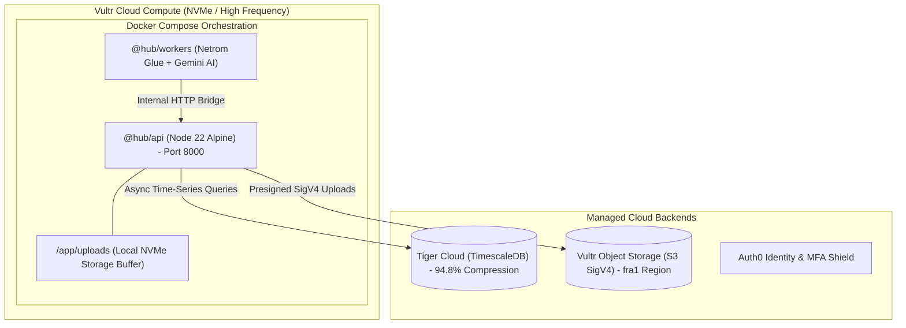

# ☁️ Vultr Cloud Deployment & High-Performance Architecture

> **Sponsor Prize Target:** High-Performance Projects on Vultr  
> **Challenge Focus:** One-click deployment, containerized microservices, and S3-compatible Object Storage.

---

## 🌟 Architecture Overview

Timișoara City Hub is packaged as a high-performance containerized system optimized for **Vultr Cloud Compute (High-Frequency / NVMe)** and **Vultr Object Storage**:



---

## 🚀 One-Click Deployment on Vultr

To deploy the entire City Hub platform on a fresh Vultr VPS (Ubuntu 22.04 / 24.04):

```bash
# Clone the repository
git clone https://github.com/bisquitew/unihackers.git
cd unihackers

# Run the automated deployment script
./infra/vultr/deploy.sh
```

The script automatically:
1. Detects and installs Docker and Docker Compose (if not already installed).
2. Sets up environment variables.
3. Builds the lean Node.js 22 alpine multi-stage images.
4. Orchestrates the `api` and `workers` services with automated healthchecks.
5. Verifies service health on `http://localhost:8000/health`.

---

## 📦 Vultr Object Storage (S3 SigV4 Integration)

Our civic reporting and urban safety modules (`[M03_SAFETY]`, photo confirmations for heating cuts) store binary media via **Vultr High-Performance Object Storage**:

- **Location:** `services/api/src/core/storage.ts`
- **Region:** Frankfurt (`fra1.vultrobjects.com`)
- **Bucket:** `timisoara-hub-media`
- **Protocol:** AWS Signature Version 4 (SigV4) presigned PUT URLs with SHA256 HMAC authentication.
- **Resilient Fallback:** Automatically falls back to high-speed local disk storage (`uploads/`) if Vultr S3 credentials are unset, ensuring 100% uptime during offline hackathon demonstrations.

### Testing Uploads
```bash
# Generate a presigned upload URL
curl -X POST http://localhost:8000/v1/core/upload/signed-url \
  -H "Content-Type: application/json" \
  -d '{"filename": "avarie_colterm.jpg", "content_type": "image/jpeg"}'
```

---

## 🛠️ Operational Commands

```bash
# Start all containers in background
docker compose up -d

# View live container logs
docker compose logs -f api
docker compose logs -f workers

# Stop containers
docker compose down
```
